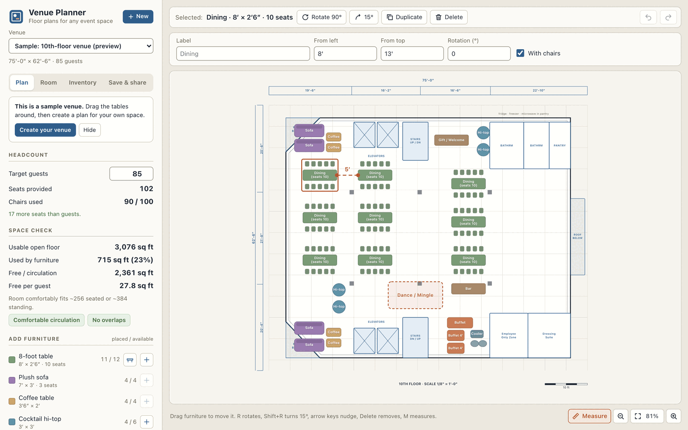
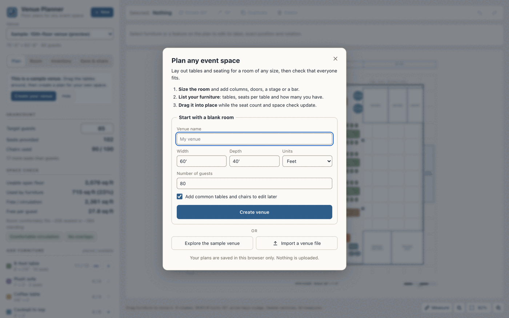
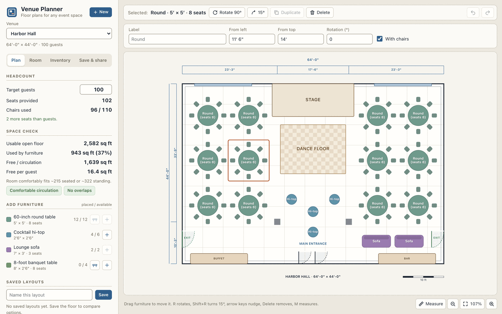
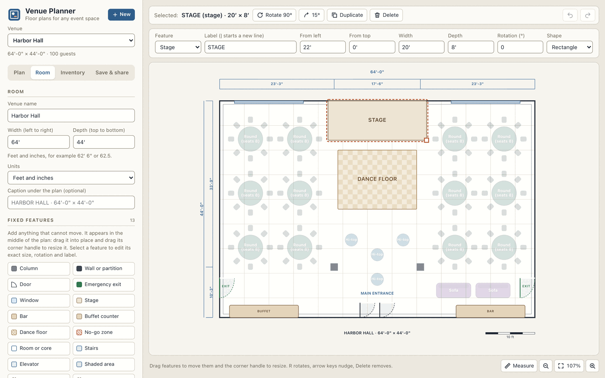
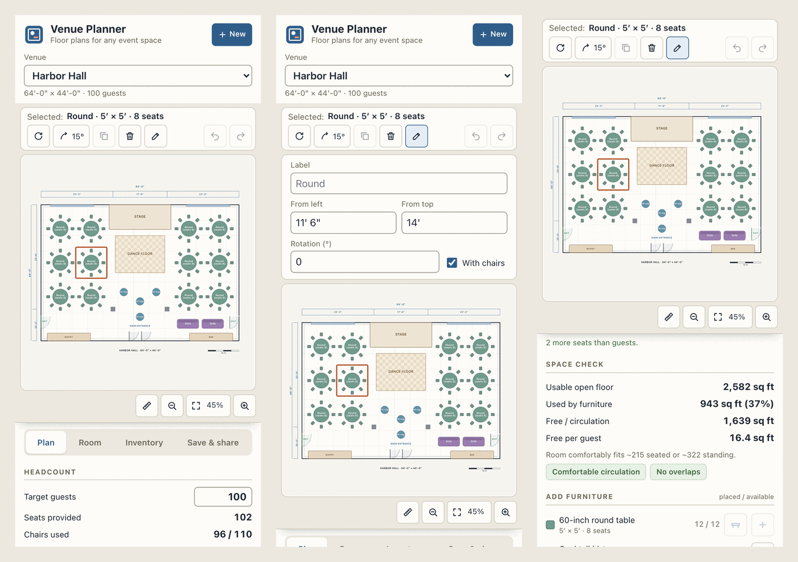

# Venue Planner

Plan seating and furniture for any event space, drawn to scale in your browser.

Size the room, mark what cannot move, list the furniture you actually have, then drag tables into place while a live seat count and space check tell you whether everyone fits. There is no account, install or build step, and your plans stay in your browser.



## Features

- **Any room.** Width and depth in feet and inches or in meters, from 4 to 1,000 feet per side.
- **Fixed features.** Columns, walls and partitions, doors, emergency exits, windows, a stage, bar, buffet counter, dance floor, stairs, elevators, rooms, no-go zones, shaded areas and text labels. Drag to move, drag the corner handle to resize, rotate, or type exact values.
- **Your inventory.** Item types for banquet and round tables, rows of chairs, sofas or any other piece, each with a size, seats, the quantity you own and a color. The planner will not place more than you own.
- **Live headcount.** Seats provided against the guest target, chairs used against chairs owned, and placed against available for every item type.
- **Space check.** Usable floor after fixed features, area used by furniture, free space per guest with a circulation rating, and flags for furniture that overlaps, extends past a wall, blocks a door or exit, or sits on the dance floor.
- **Tape measure.** Drag between any two points to read the distance, for example to check an aisle.
- **Forgiving editing.** Undo and redo, duplicate, rotate in 90 or 15 degree steps, keyboard nudging, optional grid snapping and dimension strings.
- **Many venues and layouts.** Keep several venues, and save named layouts within each one to compare options.
- **Local-first.** Autosaves in the browser. Export and import JSON files, download a PNG, print or save as PDF, or share a link that carries the whole plan.
- **Mouse, touch and keyboard.** Works from a phone to a desktop, with labelled controls and visible focus for keyboard and screen reader users.
- **Optional sync.** Connect a free Supabase project of your own so people can sign in and sync venues across devices.

## Screenshots

| Start from a blank room, the sample or a file | Your own venue with live headcount and space check |
| --- | --- |
|  |  |

| Fixed features with exact size and rotation | Phone layout |
| --- | --- |
|  |  |

## Quick start

Clone the repository and serve the folder with any static file server:

```bash
git clone https://github.com/Bakar404/venue-planner.git
cd venue-planner
python3 -m http.server 8000
```

Then open http://localhost:8000. Opening `index.html` straight from disk also works. There is nothing to install or build.

On a first visit, a start dialog offers three ways in:

- **Start with a blank room.** Enter a name, the room size and the number of guests. Tick "Add common tables and chairs" for starter furniture you can edit.
- **Explore the sample venue.** A complete plan for the 75 ft by 62 ft 6 in event floor this tool was first built for, with 85 guests and 102 seats. It stays a preview until you change something; then it is saved as your own copy.
- **Import a venue file** that you exported earlier.

## Model your venue

1. **Room.** In the Room tab, name the venue, set the width (left to right) and depth (top to bottom), and choose feet and inches or meters. Lengths can be typed as `62' 6"`, `62'-6"`, `62 6`, `62.5`, `19.05m` or `1905cm`.
2. **Fixed features.** Choose a feature to add it in the middle of the plan, drag it into place, and drag its corner handle to resize it. Select it to type an exact position, size, rotation, label or shape. Solid features such as columns, walls, a stage or a bar are subtracted from the usable floor. Doors, exits and the dance floor keep their area but must stay clear. Windows, shaded areas and labels are drawing only.
3. **Furniture.** In the Inventory tab, add an item type for each kind of furniture: name, short label for the plan, kind, width, depth, seats each, how many you have (leave blank for no limit) and color. Enter how many chairs you own; tables with chairs and rows of chairs draw from that count.
4. **Layout.** In the Plan tab, set the guest target and use the + buttons under Add furniture. Each piece lands on the nearest clear spot; drag it where you want it. The headcount and space check update as you go.
5. **Compare.** Save the floor as a named layout, try another arrangement, and switch between them.

The circulation rating is based on free floor per guest: 7 sq ft or more is comfortable, 4 to 7 is tight, and less than 4 is cramped. The seated and standing capacities assume 12 and 8 sq ft of usable floor per person. These are planning rules of thumb, not a substitute for your venue's occupancy limit or local fire code.

### Keyboard

With the plan focused, Tab moves through the furniture, or through the fixed features while the Room tab is open.

| Keys | Action |
| --- | --- |
| Arrow keys | Nudge the selection 1 ft, or 5 ft with Shift (0.25 m and 1 m in metric) |
| R, Shift+R | Rotate 90 or 15 degrees |
| Delete, Backspace | Remove the selection |
| Enter | Edit the selection's details |
| Ctrl+D | Duplicate |
| Ctrl+Z; Ctrl+Y or Ctrl+Shift+Z | Undo; redo |
| M | Turn the tape measure on or off |
| Escape | Clear the measurement, leave measure mode, then deselect |

On a Mac, use Cmd in place of Ctrl.

## Data and privacy

Venues, layouts and preferences are stored in your browser's local storage, under keys that start with `vp.`. Nothing is uploaded: with the default `config.js`, the app never contacts any server other than the one serving the page, and a Content Security Policy limits what the page can load or connect to.

Local storage belongs to one browser on one device, and clearing site data deletes it. Export a file to keep a backup or to move a venue to another device.

If you used the original single-venue version of this planner in the same browser, its data (the `epp_current` and `epp_layouts` keys) is imported once into a venue named "My 10th-floor plan", including your saved layouts. The old keys are left untouched.

## Export, import and sharing

All of these are in the Save & share tab.

- **Export this venue (.json)** writes one file with the room, features, inventory, the current floor and every saved layout.
- **Import a venue file**, or drop a file onto the page, to add it as a new venue. Files are validated before anything is saved. Invalid JSON, files from other apps or from a newer version, impossible room sizes and files over 5 MB are rejected with a plain-language message, and individual broken entries are skipped with a warning. Exports from the original planner are accepted too.
- **Download the plan as PNG** renders a high-resolution image of the plan with its dimensions, caption and scale bar.
- **Print or save as PDF** prints the plan on its own, with a title.
- **Copy a link to this plan** compresses the venue into the part of the URL after `#`, which browsers never send to a server. Whoever opens the link gets their own copy, saved as a new venue, so it works for anyone who can reach the address you run the planner from. The link carries the room, features, inventory and current floor but not saved layouts, and later changes on either side are not shared.

A venue file looks like this (shortened). All lengths are in feet whatever display unit the venue uses, and `x` and `y` are the top-left corner of each piece.

```json
{
  "app": "venue-planner",
  "format": 2,
  "venue": {
    "name": "Harbor Hall",
    "units": "ft",
    "room": { "w": 64, "h": 44 },
    "target": 100,
    "chairs": 110,
    "features": [
      { "kind": "stage", "x": 22, "y": 0, "w": 20, "h": 8, "rot": 0, "label": "STAGE" }
    ],
    "types": [
      { "id": "round60", "name": "60-inch round table", "label": "Round", "style": "round",
        "w": 5, "h": 5, "seats": 8, "qty": 12, "color": "#6f9a8c" }
    ],
    "items": [
      { "type": "round60", "x": 1.5, "y": 3, "rot": 0 }
    ],
    "layouts": []
  }
}
```

## Optional cloud sync

By default the planner runs in local mode. To let people sign in with an email and password and sync their venues across devices, connect a [Supabase](https://supabase.com) project of your own:

1. Create a Supabase project. The free tier is enough.
2. Open the SQL editor and run [`schema.sql`](schema.sql). It creates a `layouts` table with one row per venue, unique on `(user_id, name)`, turns on row level security, and adds select, insert, update and delete policies that only allow rows where `auth.uid() = user_id`.
3. In the project's API settings, copy the project URL and the `anon` public key into `config.js`. The anon key is designed to be public, and row level security keeps each user's data private. Never put the `service_role` key in this file.
4. Under Authentication, set the site URL and allowed redirect URLs to the address you run the app from, such as `http://localhost:8000`. Email confirmation is on by default, so new users confirm through an emailed link before they can sign in.
5. If your project uses a custom domain instead of `*.supabase.co`, add that domain to `connect-src` in the Content Security Policy at the top of `index.html`.

Once configured, the Sync section of the Save & share tab offers sign-in. The Supabase client library is loaded from jsDelivr only when sync is configured. Sync merges in both directions: the newer copy of a venue wins, and deleting a venue on one device deletes it everywhere. Rows saved by the original planner are imported once as a venue.

## Tech and project structure

Plain HTML, CSS and JavaScript, with no framework, no build step and no runtime dependencies apart from the optional Supabase client. The plan is an SVG drawn to scale. The scripts are classic scripts that share one small `VP` namespace, so the same files run from any static server or straight from disk. It targets current versions of Chrome, Edge, Firefox and Safari.

```text
index.html           Markup, dialogs and Content Security Policy
styles.css           Styles, including the phone layout and print styles
config.js            Optional Supabase settings, empty by default
schema.sql           Table and row level security for optional sync
favicon.svg          Site icon
js/geometry.js       Polygon, rotation and overlap helpers
js/model.js          Venue model, templates, validation, space check, import, export and migration
js/storage.js        Local storage, share-link encoding and optional Supabase sync
js/plan.js           SVG rendering of the room, features and furniture
js/app.js            User interface: tabs, dialogs, dragging, inspector, tools and undo
tests/model.test.js  Unit tests for the model and storage modules
docs/screenshots/    Images used in this README
```

Templates are data, not drawing code. The sample venue and the blank room are built from the same model as any user venue, so a new template is a new data definition in `js/model.js`.

Run the unit tests with Node.js 18 or later:

```bash
node --test tests/*.test.js
```
